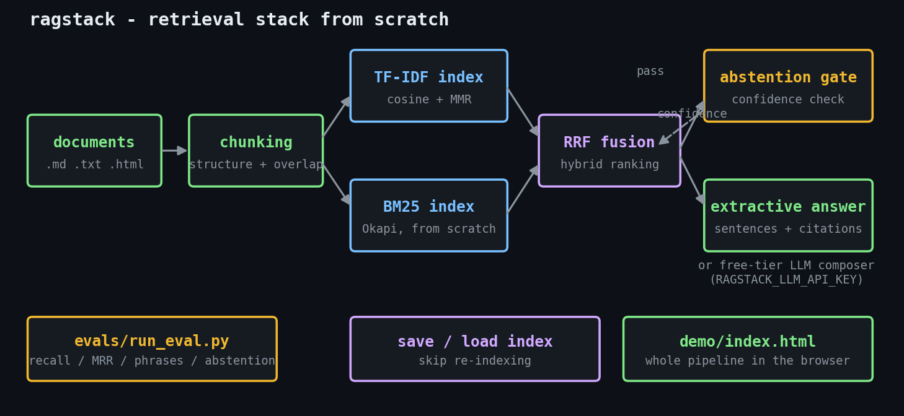
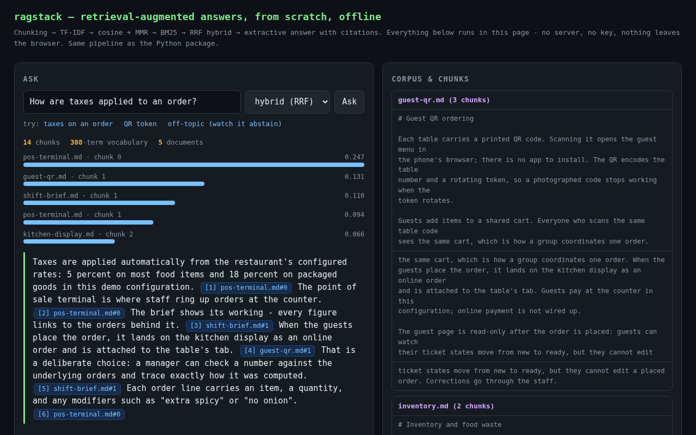

# ragstack - RAG from scratch

Retrieval-augmented generation with **no framework**: no LangChain, no
vector database, no embedding service. Chunking, TF-IDF embeddings, exact
cosine search, MMR diversification, **BM25 ranking**, **reciprocal-rank-fusion
hybrid retrieval**, an **abstention gate** and citation-grounded answer
composing, each as one small NumPy/Python module with its own tests.

Built to show the whole pipeline end to end - and measured, not asserted
(see **Measured results** below).



## Try it in your browser (no install, no key)

Run the interactive demo locally: clone the repo and open `demo/index.html` in any browser, no install and no key

`demo/index.html` is the whole pipeline ported to a single self-contained
page: open it locally and ask questions against the bundled corpus, switch
between TF-IDF / BM25 / hybrid retrieval, click a citation to see the exact
chunk it came from, or paste in your own document and watch the index
rebuild in-page. Nothing leaves the browser.



[`docs/media/demo.mp4`](docs/media/demo.mp4) is a paced headless-frame walkthrough
(7 s, captured from the real page in headless Chrome).

## What's inside

1. **Chunking** (`ragstack/chunking.py`) - packs text under a size cap,
   breaking on paragraph → line → sentence → word boundaries, with an
   overlapping tail carried into the next chunk.
2. **Embeddings** (`ragstack/embeddings.py`) - TF-IDF with sub-linear TF
   scaling and a small from-scratch stemmer, L2-normalized so dot product
   is cosine similarity.
3. **Index** (`ragstack/index.py`) - flat exact index; one matrix product
   per query. Brute force on purpose: at this scale it is exact and simple
   to verify.
4. **Retrieval** (`ragstack/retrieve.py`, `ragstack/bm25.py`,
   `ragstack/fusion.py`) - three interchangeable rankers:
   - TF-IDF top-k plus MMR, so the context is not five near-duplicates;
   - BM25 (Okapi) from scratch, adding term-frequency saturation and
     document-length normalization;
   - **hybrid**: reciprocal rank fusion of the two, the default.
5. **Abstention gate** (`RagStack.answer`, `confidence()`) - when the best
   chunk shares no meaningful content words with the question, the stack
   says so instead of stitching a confident non-answer.
6. **Answering** (`ragstack/generate.py`) - a deterministic extractive
   composer: it stitches adjacent retrieved chunks back into whole
   passages, picks the sentences that best overlap the question, and cites
   a chunk in the source passage. An optional free-tier LLM backend
   (any OpenAI-compatible endpoint via `RAGSTACK_LLM_API_KEY`) can phrase
   the answer instead, restricted to the retrieved chunks and required to
   cite them.
7. **Persistence** (`RagStack.save` / `RagStack.load`) - save a built index
   once, reload it later, skip re-indexing; retrieval is bit-identical.
8. **Ingestion** (`ragstack/ingest.py`) - loads `.md`/`.txt` and strips
   `.html` to text with the stdlib parser.

## Quickstart

```bash
pip install -r requirements.txt          # just numpy

# index once, ask many times
python3 -m ragstack.cli build data/demo-corpus /tmp/rs-index
python3 -m ragstack.cli ask /tmp/rs-index "How are taxes applied to an order?"
python3 -m ragstack.cli ask /tmp/rs-index --retriever bm25 "Where do guests pay?"

# legacy one-shot (re-indexes each run) and interactive stdin still work
python3 -m ragstack.cli data/demo-corpus "How are taxes applied to an order?"

# watch it decline an off-topic question
python3 -m ragstack.cli ask /tmp/rs-index "What is the capital of France?"
```

## Tests and eval

```bash
pip install -r requirements-dev.txt
python3 -m pytest tests/ -q     # 64 tests
python3 -m evals.run_eval       # retrieval + answer + abstention eval
```

## Measured results

Executed on this machine, 2026-11-13, Python 3.10, against the bundled
5-document demo corpus (~900 words each):

- **64/64 unit tests pass** (`python3 -m pytest tests/ -q`).
- **Retrieval, original 15-question fixture** (`evals/questions.json`,
  unchanged since 0.1): recall@5 **15/15** for all three retrievers
  (tfidf, bm25, hybrid); MRR@5 0.967 each (`python3 -m evals.run_eval`).
- **Retrieval, wording-shifted probe** (`evals/wording_probe.json`, 5 new
  paraphrased questions): recall@5 **4/5** for all three retrievers; MRR@5
  0.800 (tfidf, hybrid), 0.700 (bm25). The miss is real and printed by the
  eval - this probe is where the lexical limit shows.
- **Answer key-phrase coverage: 17/20** across both fixtures with the
  extractive composer on hybrid retrieval; the 3 misses are the
  wording-shifted probe questions, visible in the eval output.
- **Abstention gate: 23/25 correct decisions** - all 20 in-scope questions
  answered, 3 of 5 clearly off-topic questions abstained. The two failures
  share exactly one topical word with the corpus ("forecast", "five");
  both are printed by the eval, not hidden.

Scope of these numbers, honestly: the corpus is the 5 small bundled
documents and the questions are written against it, so everything here is
in-sample. The numbers say the machinery works end to end and where it
breaks; they are **not** a claim about large corpora or unseen question
distributions.

## Honest limits

- Retrieval is **lexical** - TF-IDF and BM25 both match words, not meaning.
  The hybrid fuses two lexical signals; it does not add semantics. The
  wording-shifted probe above exists to make that limit measurable: 4/5.
- The abstention gate is a heuristic on one cosine score. Fully off-topic
  questions are caught; questions sharing a single topical word with the
  corpus can slip through (2 of 5 did, shown above).
- The index is exact and in-memory - fine for thousands of chunks, not for
  millions.
- The extractive composer quotes; it does not paraphrase or synthesize
  across sources. The optional LLM backend does, but its output quality is
  not part of the measured numbers above.
- `evals/questions.json` was used during development, so 15/15 on it is
  in-sample. `wording_probe.json` was added in 0.2 to probe, not to flatter.

## Layout

```
ragstack/      the library (chunking, embeddings, index, retrieve, bm25,
               fusion, generate, ingest, pipeline, cli)
tests/         64 unit tests
evals/         original fixture + wording probe + out-of-scope fixture + runner
data/demo-corpus/  5 short docs used by the demo and the eval
demo/          build_demo.py -> index.html (self-contained browser demo)
docs/media/    architecture diagram, demo screenshot, recorded walkthrough
```

Citation caveat: sentences spanning merged chunks currently point to one
chunk in the passage, not an exact character span. Optional LLM citations
are requested by prompt, not a guarantee of factual grounding. Answers can
include tangential sentences with overlapping words (visible in the demo
screenshot above).
